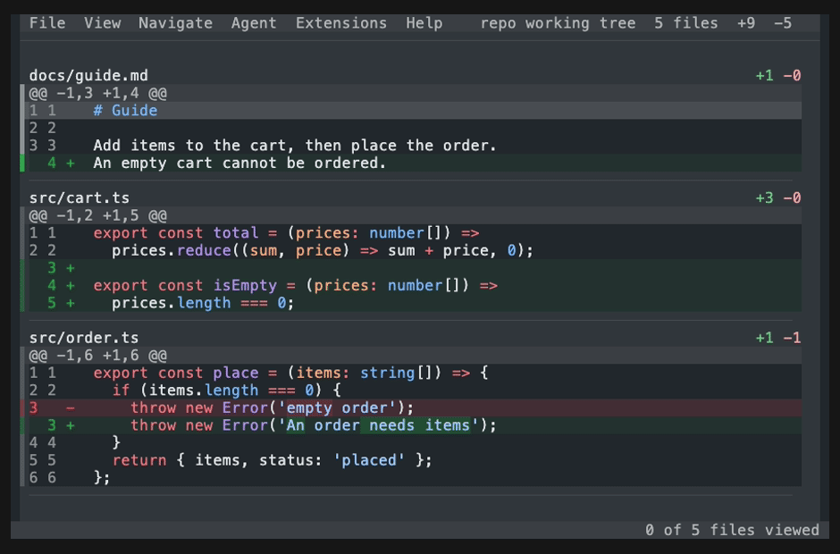

# hunk-viewed

GitHub-style **Viewed** marks for [Hunk](https://hunk.dev): press `x` to mark a hunk viewed, `X` for the whole file, fold what you have seen, see your progress and move on to what is left.



## Install

```bash
hunk extension install RubenFricke/hunk-viewed
```

Requires Hunk 0.24.0 or newer (extension API 31). Releases are tagged, so you can pin one: `hunk extension install RubenFricke/hunk-viewed@v0.3.1`.

## What you get

| Key | Command id               | What it does                                                                                                                                                                               |
| --- | ------------------------ | ------------------------------------------------------------------------------------------------------------------------------------------------------------------------------------------ |
| `x` | `hunk-viewed.toggleHunk` | Mark the selected hunk viewed, dim it, and jump to the next hunk you have not viewed. When that was the last hunk of its file, the file folds. On a viewed hunk: drop its mark and stay.   |
| `X` | `hunk-viewed.toggleFile` | Mark the whole file viewed, fold it to its header and one `✓ Viewed` row, and jump to the next file you have not viewed. On a folded file, `x` and `X` both unfold it with no hunk viewed. |

The status line shows `3 of 12 files viewed` on the right, and `1 of 3 hunks viewed` on the left while the current file is partly viewed. After the last hunk or file, the jump goes back to the first unviewed one above. When every file is viewed, a notice says `All 12 files viewed`; when only files hidden by the filter are left, it says `No unviewed file is visible`.

## How it works

- **A viewed hunk is dimmed.** Hunk recedes its text toward the background and keeps the diff colors. A file view can only fold a whole file, so a hunk stays in place until the last hunk of its file is viewed; then the file folds. A folded file was viewed as a whole, so opening it again, with `x` or `X`, starts over with no hunk viewed.
- **The fold keeps the review intact.** A viewed file shows its own header plus one `✓ Viewed` row. `j` and `k` still stop there, once per file, and the cards of your notes stay under it.
- **The jump** takes the next unviewed hunk below the selection, in this file or a later one, and after the last one the first unviewed hunk above. A file without hunks, such as a binary one, is one stop. Only files the filter shows take part.
- **Folds come back by themselves.** Hunk forgets the presentation of a file when a reload renumbers it, so every fold brings every viewed file back in line with the marks. No separate command to fold again. That also means a viewed file you set back to the raw diff by hand folds again on the next fold; drop its mark with `X` instead.
- **A mark holds a hash of the changes.** A file mark hashes the file's hunks, a hunk mark hashes that one hunk. A reload that changes those lines drops the mark, like GitHub does, and a notice counts the files that changed. Lines that merely moved up or down keep it.
- **Other extensions can follow along.** Every file mark, unmark and dropped mark sends `hunk-viewed:changed` on Hunk's event bus with `{ viewed: string[] }`, the paths of every viewed file in review order. Hunk marks are not in it.

  ```ts
  hunk.events.on<{ viewed: string[] }>('hunk-viewed:changed', ({ viewed }) => {
    // viewed: ['src/cart.ts', 'src/order.ts']
  });
  ```

## Configuration

One setting, and the two keys, shown here with their defaults. The keys are remapped like any Hunk command.

```toml
# ~/.config/hunk/config.toml
[extension.hunk-viewed]
hunk_progress = true   # "1 of 3 hunks viewed" on the status line while a file is partly viewed

[keybindings]
"hunk-viewed.toggleHunk" = "x"
"hunk-viewed.toggleFile" = "X"
```

## What it reads and writes

Nothing of its own. Marks live in memory for the session, the same way Hunk keeps its own review notes: no files of its own, no network, no shell commands, and nothing to clean up. To fold a file it reads that file's source through Hunk, read-only, like every file view; nothing of it is kept. Quit Hunk and the marks are gone.

## Compatibility

hunk-viewed follows the newest Hunk release. CI tests every pull request against the oldest Hunk that hunk-viewed supports and against the newest Hunk release, and checks the newest again every day. When a new Hunk release breaks something, the fix comes in a new hunk-viewed release.

Each release lists the Hunk it needs. When a release raises that minimum, its notes say which earlier release still works with an older Hunk. If your Hunk is too old, Hunk itself tells you at startup.

## Known limitations

- **Notes stay visible.** A viewed file with notes folds, but the note cards keep showing under the `✓ Viewed` row. Hunk has no way yet for a file view to summarize them.
- **Files without a source,** such as a submodule or a patch from stdin, fold too, but `j` and `k` skip them; `[`, `]`, `,` and `.` still reach them. For submodules, `git config diff.submodule diff` gives Hunk the lines it needs.
- **Dimming is subtle.** Hunk sets how far a dimmed hunk recedes, and the red and green line backgrounds stay, so a viewed hunk takes the same room as before. Only a whole file folds. The hunk count on the status line is there for that reason.
- **A hunk of more than 2,000 lines does not dim.** Hunk accepts at most 2,000 dimmed lines per file; above that it shows a warning and dims nothing in that file. The hunk count on the status line still counts it, and the file folds like any other once its last hunk is viewed.
- **After a reload that adds or removes a file,** the viewed files after it show unfolded until the next fold. Hunk keeps a file's presentation by its position in the list.

## Development

```bash
bun install
bun run check                                # typecheck, lint, format, knip, tests
hunk diff --extension /path/to/hunk-viewed   # try a checkout without installing
./demo/record.sh                             # re-record the README demo (needs vhs)
```

Hunk names an extension after its folder, so keep a checkout in a folder called `hunk-viewed`; the command ids and the config table above depend on it.
